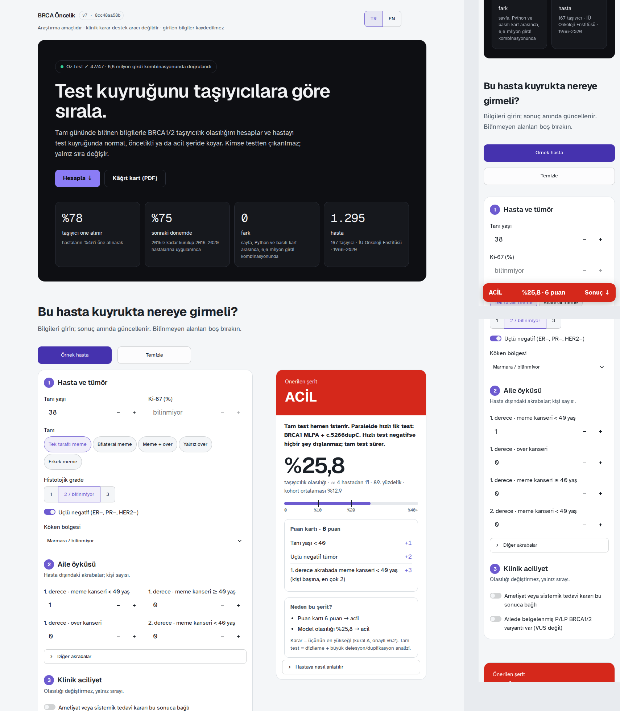

# BRCA Öncelik Hesaplayıcı · BRCA Priority Calculator

**Araştırma prototipi; klinik karar destek aracı değildir. Research prototype, not a clinical decision-support tool.**

Tanı gününde bilinen bilgilerle BRCA1/2 taşıyıcılık olasılığını hesaplar ve hastayı test kuyruğunda normal, öncelikli ya da acil şeride koyar. Varsayılan kullanımda kimse testten çıkarılmaz, yalnız sıra değişir; test azaltma varsayımsal bir araştırma senaryosudur.

Estimates BRCA1/2 carrier probability from what is known on the day of diagnosis and places the patient in the normal, priority or urgent lane of the test queue. By default nobody is removed from testing, only the order changes; test reduction is a hypothetical research scenario.



- **Kohort / cohort:** geliştirme kohortu, 1.295 hasta (167 taşıyıcı), tanı yılları 1988–2020.
- **Doğrulama / validation:** iç içe çapraz doğrulama; hastaların %48'i öne alınır, taşıyıcıların %78'i kapsanır. 2015'e kadar kurulup 2016–2020'ye uygulanınca %38 / %75.
- **Hesap denetimi / calculation audit:** yayımlanan HTML hesaplayıcı, bağımsız Python ve basılı kâğıt kart 6.635.520 girdi kombinasyonunda aynı sonucu verir. Bu uygulamanın çekirdeği (`brca_core.py`) HTML hesaplayıcıyla 200.000 profilde aynıdır. Özet: `verification.json`, `test_app_results.json`.
- **Veri / data:** depoda hasta verisi yoktur. `model_full_embedded.json` yalnız model katsayılarını ve toplu doğrulama sayılarını içerir; `selftest_vectors_synthetic.json` sentetik referans hastalardır. Uygulama girilen bilgileri kaydetmez.

```
pip install -r requirements.txt
streamlit run app.py
```

Uygulama şifre ister: Streamlit Cloud → App settings → Secrets içine `APP_PASSWORD = "..."` yazın (yerelde `BRCA_APP_PASSWORD` ortam değişkeni ya da `BRCA_NO_PASSWORD=1`). Şifre kodda veya depoda tutulmaz.

Varsayılan karar kuralı A'dır (onaylı v6.2). `?kural=B` adresi, karar bekleyen öneri B'yi önizler.

**Test azaltma araştırma görünümü / Test-reduction research view:** `?mod=azalt` yalnız varsayımsal kurala uygunluğu gösterir; hastaya test atlama talimatı vermez. Tam test planı her iki görünümde korunur. / Shows hypothetical eligibility only; never instructs the patient to skip testing. The full-test plan remains in both views.

`rule_out_policy.json` contains stored exploratory nested-CV and temporal summaries. Its generating script and policy approval record are not included in the available package; the app explicitly discloses this limitation. Approximate intervals from repeated validation are not independent clinical safety guarantees.

**Laboratuvar kapasitesi / Laboratory capacity explorer (v7.1):** Compare A, B and model ranking at matched workload; explore six measured rapid-test triggers with a scatter plot, package-ceiling filter and CSV download. Switch between nested CV (1,295 patients, 167 carriers; five-repeat means) and temporal evaluation (477 patients, 52 carriers). The package ceiling refers to the selected historical cohort, not monthly throughput. Controls never change the patient calculator. Full testing continues for everyone; rapid-test packages are additional tests. The app reports target detectability, not measured time savings or clinical outcomes. No interpolation between tested thresholds or projections to new populations.

Aggregate evidence is copied unchanged from the October 4 Drive analysis into `evidence/rapid_threshold.json` and `evidence/matched_workload.json`. Source links, retrieval date and SHA-256 checksums are in `evidence/sources.json`. No patient-level records are included. B remains a proposal; its displayed queue figures use model-only validation (44% prioritised / 76.5% of carriers), while A uses combined validation (48% / 77.8%). Urgency effects were not measurable in the cohort. A familial P/LP variant suppresses the personal probability headline and one-in-N interpretation because that information is absent from the cohort model.

**Araştırma özeti / Research overview (v7.2):** Select **Araştırma özeti** above the calculator, or open `?sayfa=arastirma`. The Turkish/English presentation shows the October 24 curated archive (2,148 genetic identities, 1,445 accepted clinical links, 143 confirmed-BRCA breast family representatives), the existing 87-family tumor-size result and its uncertainty, remaining identity/family gaps, and the exact independent-validation data requirements. The size ratio is 0.6487 (95% CI 0.4206–1.0007), p=0.05035, cumulative q=0.5273; it remains unvalidated. These are distinct cohorts from the calculator's 1,295-patient development evidence.

The overview reads five aggregate-only snapshots in `evidence/research/`, with source SHA-256 checksums in its `sources.json`. It runs no statistical analyses and changes no model coefficients or clinical decision rules. The download is a self-contained HTML summary that opens offline and can be printed. Patient-level files, private identifiers, and local research-folder paths are excluded. Switching views preserves calculator inputs and laboratory-capacity controls; the existing password gate protects both views and downloads.

**Calculator update audit (24 October 2026):** Both views and the offline summary present `evidence/calculator_validation_eligibility.json`. The original Drive OOF roster identifies 206 linked patients outside development; 20 have recorded development-family overlap and one lacks an eligible cancer record. The remaining 185 patients form 184 recorded family groups. Selecting a representative before completeness filtering leaves 111 with complete core inputs. Reconciliation of all 53 enumerated allele/classification gaps adds 42 report-supported candidates to the earlier 49, yielding **91 (14 positive, 77 negative)**. Forty rely on a 2015 paper in Drive classifying the exact NM_000059.3:c.7008-62A>G / rs76584943 allele as Uncertain; this is explicitly historical VUS evidence, not benignity or current clinical sign-off. **Without that historical dependency, the count is 51 (14 positive, 37 negative).** Excluded artifact calls remain excluded from the conservative candidate set. Twenty core-complete records still need outcome support (five artifact/QC adjudications, eight sequencing-scope confirmations, five copy-number results, two interpretable original reports); 73 representatives lack core inputs. All 91 are breast-cancer cases, 20 lack diagnosis year and 59 lack optional Ki67. Prediction-time provenance, laboratory scope/QC and selection remain unresolved. Twenty-nine of the 32 newly recovered patients already belonged to development. No probabilities, calibration, thresholds or performance claims were updated. Private record-level artifacts stay outside this public repository.

**Verification:**

```
python -m unittest discover -s tests -v
```

The suite tests source checksums, recorded workload/yield totals, budget boundaries, policy-specific evidence, bilingual app flows, familial-variant output, hypothetical reduction, independence of capacity controls from patient decisions, research-view routing/authentication, preserved inputs across views, and uncertainty/source fidelity in the offline summary. `verification.json` and `test_app_results.json` remain historical records of the original calculator; the 47 synthetic startup checks cover probability calculation only. Model coefficients and patient decision rules A/B are unchanged.

Prof. Dr. Hülya Yazıcı · Dr. Öğr. Üyesi Arif Solmaz · İstanbul Sağlık ve Teknoloji Üniversitesi (İSTÜN)
